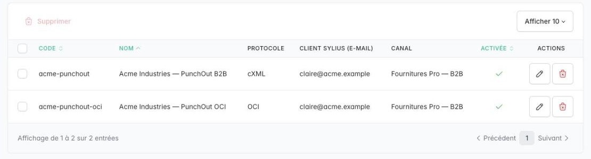
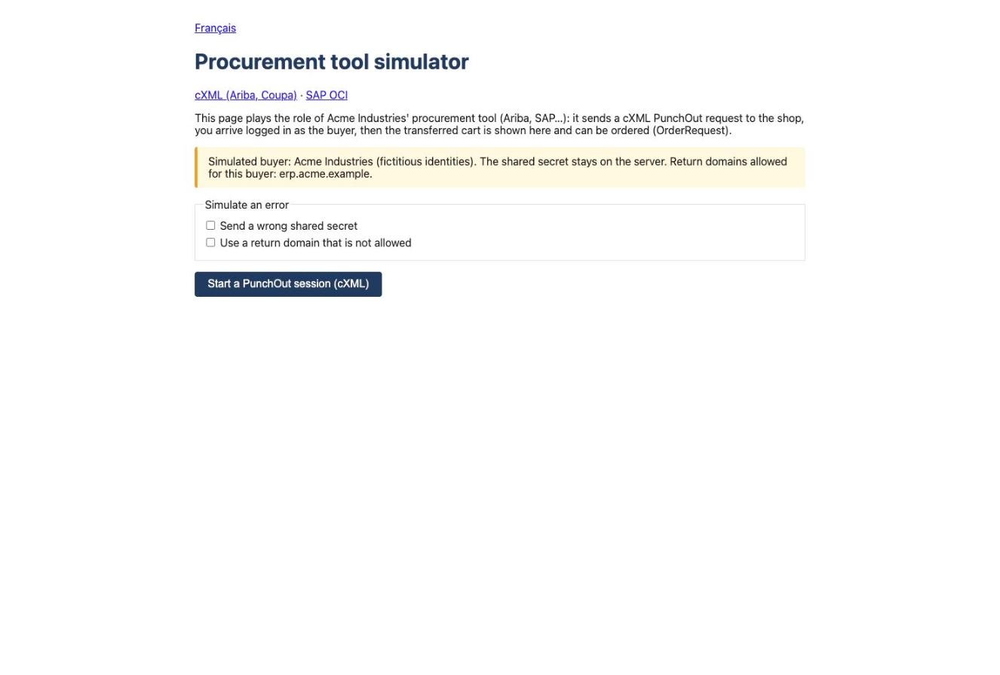

# Plugin Sylius PunchOut cXML/OCI

> English: [README.md](README.md) <!-- vitrine:lang -->

[](https://github.com/thibmonier/sylius-punchout-cxml-plugin/actions)
[](LICENSE)

PunchOut pour Sylius 2 : les acheteurs B2B ouvrent votre boutique depuis leur système d'achat (SAP Ariba, Coupa,
Jaggaer, Oracle…), achètent à leurs propres prix et renvoient le panier vers leur demande d'achat.

Version 1.1 : cXML PunchOut `create`, `edit` et `inspect`, `ProfileRequest`, bons de commande
(`OrderRequest`) transformés en commandes Sylius, entrée SAP OCI 5.0, retour, `VALIDATE` et `DETAIL`, transfert
et annulation du panier, codes et unités UNSPSC, taxes et livraison en option, journal des échanges — avec protection
contre le rejeu, limitation de débit et prise en charge des iframes — administration des acheteurs, simulateur d'acheteur, purge de rétention, effacement RGPD
et commande de diagnostic.
Spécification et feuille de route : [`project-management/`](project-management/).

## Fonctionnement

1. Le système d'achat envoie un `PunchOutSetupRequest` en `POST /punchout/cxml`. L'acheteur est
   authentifié par ses identités `From` / `Sender` et son secret partagé (stocké sous forme de hash Argon2id)
   et reçoit une URL de démarrage à usage unique (`StartPage`).
2. Le navigateur de l'utilisateur ouvre l'URL de démarrage : il est connecté en tant que **client Sylius lié à
   l'acheteur** (ses prix et ses groupes s'appliquent), dans un panier dédié, isolé de son panier habituel.
3. Sur la page du panier, *Transfer* envoie un `PunchOutOrderMessage` (`cXML-base64`, `target="_top"`) au
   système d'achat : prix nets (la taxe incluse dans le prix est retirée), totaux hors taxe et hors
   livraison. *Cancel* envoie le même message sans articles. La session PunchOut est ensuite fermée.
   Pendant la session, le tunnel de commande Sylius ramène au panier : les commandes sont passées dans le
   système d'achat.

Le point d'entrée de configuration n'ouvre jamais de session (pas de cookie), il est soumis à une limitation de débit par adresse (HTTP 429) et
refuse les requêtes rejouées (même `payloadID`, ou `timestamp` en dehors de la fenêtre de rejeu). L'URL de
retour doit être en HTTPS et correspondre à l'un des domaines autorisés de l'acheteur (refus par défaut) ; elle est vérifiée lors de
la configuration, puis de nouveau avant l'envoi du panier. Une session PunchOut ouverte expire après
`session_lifetime`.

## Bons de commande (cXML OrderRequest)

Une fois la demande d'achat validée, le système d'achat peut envoyer le bon de commande
(`OrderRequest`) au même point d'entrée. Il n'est accepté que pour les acheteurs disposant d'une **méthode de paiement des
bons de commande** (par exemple une méthode hors ligne « sur compte » ; méthode de livraison facultative, sinon la première
disponible pour l'adresse de livraison). La commande est créée comme une commande Sylius ordinaire (numéro, stock,
e-mails), avec les adresses `ShipTo` / `BillTo` et le numéro du bon de commande dans ses notes :

- une commande par acheteur et par `orderID` : un renvoi — même du document strictement identique après un délai d'attente —
  répond 200 avec la même commande ; le même `orderID` avec un autre contenu est refusé (400) ;
- un article qui n'est plus vendu ou en rupture de stock, une quantité hors de la plage 1 à 9999, un pays que le canal
  ne dessert pas, ou un prix unitaire net (ou une devise) différent du bon de commande refuse l'ensemble du
  bon de commande (cXML 400, lignes nommées) : l'acheteur relance un `edit` PunchOut ;
- les bons de commande `update` / `delete` et les documents `deploymentMode="test"` ne créent aucune commande (450) ;
- au plus `rate_limits.order_requests` nouveaux bons de commande par acheteur (60 par heure par défaut).

La commande appartient au client de l'acheteur, en tant que client autorisé (pas une commande invité), de sorte que
les plugins qui réservent le paiement sur compte aux clients connus l'acceptent.

**Événement.** Une fois la commande validée en base, `Tmonier\SyliusPunchoutCxmlPlugin\Order\PunchoutOrderCreated`
est dispatché une seule fois, avec `purchaseOrderId` (l'`orderID` du bon de commande de l'acheteur), la
commande Sylius `order` et l'acheteur `buyer`. Un renvoi ou un bon de commande refusé ne dispatche rien. Écoutez-le
plutôt que de lire les notes de la commande. Les écouteurs s'exécutent de façon synchrone dans la requête et ne doivent pas lever d'exception :
une exception est journalisée et la réponse cXML reste 200, puisque la commande est déjà enregistrée.

**Les paniers PunchOut ne peuvent pas être finalisés.** Une garde sur la transition `complete` de `sylius_order_checkout`
(Symfony Workflow et winzou) refuse de finaliser un panier ouvert par une session PunchOut, ce qui ferme
`PATCH /api/v2/shop/orders/{token}/complete`. Les commandes issues d'un `OrderRequest` et les commandes de la boutique ne sont pas
concernées. Limite : avec `keep_transferred_carts`, la purge de rétention supprime la session et conserve le
panier, qui n'est alors plus reconnu comme un panier PunchOut.

**Doctrine.** Les relations vers la commande, le client et le canal Sylius ciblent `OrderInterface`,
`CustomerInterface` et `ChannelInterface`. Sylius les résout vers vos classes de modèle
(`resolve_target_entities` est enregistré par Sylius pour ses ressources) : une application qui surcharge
ces modèles n'a besoin d'aucune entrée supplémentaire. Vérifiez avec `bin/console doctrine:schema:validate`.

Le secret partagé d'un tel acheteur peut désormais passer des commandes sur compte : protégez-le comme un
identifiant de paiement. Voir [ADR-0008](docs/adr/0008-order-request.md).

## SAP OCI

Un acheteur utilisant le protocole **OCI** entre avec `POST https://<shop>/punchout/oci/<buyer code>` et les
paramètres `USERNAME`, `PASSWORD` et `HOOK_URL` (réglez la méthode HTTP de l'appel au catalogue sur POST dans
SAP). Une entrée en `GET` est refusée (405) sauf si `oci_allow_get: true` : le mot de passe se retrouverait dans les
journaux d'accès de chaque proxy traversé et dans l'historique du navigateur. L'identifiant est défini sur l'acheteur, le mot de passe est le
secret de l'acheteur (même hash Argon2id, même rotation et même valeur imposée qu'un secret cXML) ; les échecs sont limités
comme les authentifications cXML. Un acheteur OCI ne s'authentifie jamais sur le point d'entrée cXML. `HOOK_URL` doit correspondre aux domaines de retour de l'acheteur. L'utilisateur est connecté
immédiatement, sans URL de démarrage.

*Transfer* envoie les champs OCI 5.0 à `HOOK_URL` : `NEW_ITEM-DESCRIPTION` (40 caractères),
`QUANTITY`, `UNIT`, `PRICE` (net), `CURRENCY`, `PRICEUNIT`, `VENDORMAT`, `EXT_PRODUCT_ID`, la catégorie
UNSPSC lorsque l'article en a une et la description complète dans `NEW_ITEM-LONGTEXT_n:132[]` ; les champs
`~` reçus à l'entrée (`~OkCode`, `~TARGET`, `~CALLER`) sont renvoyés. Le formulaire cible
`returntarget`, sinon `~TARGET`, sinon `_top`, dans le jeu de caractères `http_content_charset` (UTF-8 par défaut).
*Cancel* n'envoie aucun article.

Fonctions OCI (mêmes identifiants et même `HOOK_URL`) : `FUNCTION=VALIDATE` avec `PRODUCTID` (l'
`EXT_PRODUCT_ID` envoyé par le transfert) et `QUANTITY` renvoie directement l'article au prix
actuel de l'acheteur, sans ouvrir de session (aucun article s'il n'est plus vendu) ; `FUNCTION=DETAIL` avec
`PRODUCTID` ouvre sa fiche produit dans une session PunchOut. Les autres fonctions (`SOURCING`,
`BACKGROUND_SEARCH`…) sont refusées (HTTP 400).

## Demandes d'achat, classification et journal

- **edit** reconstruit le panier à partir des articles de la demande d'achat (`SupplierPartAuxiliaryID` écrit par
  le transfert, sinon `SupplierPartID`) ; les articles qui ne sont plus vendus sont écartés et signalés. **inspect**
  affiche la demande d'achat en lecture seule ; le retour envoie un message sans articles.
- Chaque ligne porte une `Classification` **UNSPSC** et une `UnitOfMeasure` : définissez-les sur le produit
  (code et unité) ou sur la catégorie (code, hérité par ses produits et ses sous-catégories) dans l'administration ; l'
  acheteur définit les valeurs par défaut. Décorez `tmonier_punchout.classification.item_classifier` pour les récupérer
  ailleurs.
- L'acheteur choisit si la **taxe** et la **livraison** du panier sont envoyées.
- **Journal PunchOut** (administration) : chaque échange avec son statut cXML et le SHA-256 de son corps ; avec
  `log_bodies: true`, le corps lui-même, sans les secrets partagés et avec les adresses e-mail masquées.

## Captures d'écran



*Acheteurs PunchOut en administration : acheteurs cXML et OCI liés à un client Sylius et à un canal (recadrage du tableau)*



*Simulateur d'outil d'achat de la démo, depuis lequel on lance une session PunchOut*

## Prérequis

PHP 8.2+, Sylius 2.2.9+ ou 2.3+, Symfony 7.4 / 8, ext-dom, ext-libxml. Aucune bibliothèque cXML
tierce : les documents sont lus et écrits avec DOM (voir [ADR-0002](docs/adr/0002-serialisation-cxml-dom.md)).

## Installation

```bash
composer require tmonier/sylius-punchout-cxml-plugin
```

```php
// config/bundles.php
Tmonier\SyliusPunchoutCxmlPlugin\TmonierSyliusPunchoutCxmlPlugin::class => ['all' => true],
```

```yaml
# config/packages/tmonier_punchout.yaml — admin grids, twig hooks and default supplier identity
imports:
    - { resource: "@TmonierSyliusPunchoutCxmlPlugin/config/config.yaml" }
```

```yaml
# config/routes/tmonier_punchout.yaml
tmonier_sylius_punchout_cxml:
    resource: "@TmonierSyliusPunchoutCxmlPlugin/config/routes.yaml"
```

```bash
php bin/console doctrine:migrations:migrate
```

## Configuration

```yaml
# config/packages/tmonier_punchout.yaml
tmonier_sylius_punchout_cxml:
    supplier_identity:               # your identity in the messages sent back (From / Sender)
        domain: '%env(PUNCHOUT_SUPPLIER_DOMAIN)%'      # defaults to NetworkId
        identity: '%env(PUNCHOUT_SUPPLIER_IDENTITY)%'  # defaults to "supplier": set your Ariba Network ID or equivalent
    start_token_ttl: 300             # seconds
    session_lifetime: 28800          # seconds an open PunchOut session lasts
    replay_window: 900               # accepted clock skew of the setup timestamp, in seconds
    max_request_bytes: 262144        # 256 KiB
    max_items_out: 500               # items of a requisition (edit / inspect)
    log_bodies: false                # keep the masked bodies in the PunchOut log
    retention_days: 90               # log entries and sessions kept (tmonier:punchout:purge)
    rate_limits:
        setup: { limit: 30, interval: '1 minute' }                                 # per client address
        authentication_failures: { limit: 10, interval: '1 minute' }               # per identity and address
        authentication_failures_per_identity: { limit: 50, interval: '1 minute' }  # per identity, all addresses: further failures get 429, right credentials still pass
        oci_entry: { limit: 30, interval: '1 minute' }                             # OCI entries per client address
        order_requests: { limit: 60, interval: '1 hour' }                          # new purchase orders per buyer
    keep_transferred_carts: false
    oci_allow_get: false             # accept the OCI entry by GET (not recommended)
    allowed_extrinsics: [UserEmail, UniqueName, CostCenter]
```

## Configurer un acheteur

Dans l'administration, **PunchOut buyers > Create** : code, nom, canal, le client Sylius sous lequel les sessions se
connectent (obligatoire), pour un acheteur OCI son identifiant, pour un acheteur cXML ses identités `From` et `Sender` (une `domaine identité` par ligne, par ex.
`NetworkId AN01000000001`), les hôtes de retour autorisés (`s1.ariba.com` pour exactement cet hôte,
`*.ariba.com` pour ses sous-domaines ; jamais un suffixe public tel que `*.github.io`) et, si le système d'achat affiche la boutique dans
une iframe, ses origines (`https://s1.ariba.com`).

Le secret partagé est généré à la création et **affiché une seule fois**. *Generate a new secret* en ajoute un à côté
du secret actuel (rotation sans interruption : deux secrets au plus sont actifs), puis révoquez l'ancien ; un
secret imposé par le système d'achat peut être saisi à la place (16 caractères minimum). Communiquez au
système d'achat votre URL de configuration (`https://<shop>/punchout/cxml`), votre identité de fournisseur et le
secret.

## Comptes d'entreprise

Avec [tmonier/sylius-company-accounts-plugin](https://github.com/thibmonier/sylius-company-accounts-plugin)
installé, un acheteur peut être rattaché à une entreprise : son client lié doit alors être un membre actif
de cette entreprise (la commande doctor le signale lorsque ce n'est plus le cas). Sans ce plugin, le champ
entreprise n'apparaît pas.

## Commandes de la console

```bash
bin/console tmonier:punchout:doctor                 # configuration and buyers check (exit 1 if an enabled buyer cannot be used)
bin/console tmonier:punchout:purge [--dry-run]      # run daily: deletes the log entries and sessions older than retention_days
bin/console tmonier:punchout:erase <email> [--dry-run]
```

`erase` supprime les données personnelles d'une personne dans les tables PunchOut : les valeurs Extrinsic des
sessions des acheteurs connectés sous ce client Sylius ou citant l'adresse, et les corps de
leurs entrées de journal (ainsi que de toute entrée affichant l'adresse sous sa forme masquée, par ex. `c***@bigcorp.example`).
Les lignes, dates, types et statuts sont conservés pour les statistiques. Le client Sylius lui-même est géré par la
boutique. Les paniers conservés avec `keep_transferred_carts` sont des paniers Sylius ordinaires : `sylius:remove-expired-carts`
les supprime.

## Derrière un proxy ou un répartiteur de charge

La limitation de débit de la configuration s'applique par adresse client : déclarez vos proxys pour que Symfony voie la vraie
adresse, sans faire confiance à plus que ceux-ci (un `X-Forwarded-For` falsifié la contournerait sinon) :

```yaml
# config/packages/framework.yaml
framework:
    trusted_proxies: '10.0.0.0/8'   # your proxies / load balancer only
    trusted_headers: ['x-forwarded-for', 'x-forwarded-proto', 'x-forwarded-host']
```

Définissez aussi `framework.trusted_hosts` avec les noms d'hôte de votre boutique : les URL renvoyées au système d'achat
sont construites à partir de l'hôte de la requête.

Avec plusieurs serveurs d'application, partagez le stockage du limiteur de débit (par exemple un pool de cache Redis
pour `cache.rate_limiter` et un store de verrous Redis), faute de quoi chaque serveur compte de son côté.

## Iframe (SAP Ariba)

Pendant une session PunchOut uniquement, les pages de la boutique peuvent être affichées dans l'iframe des origines de l'acheteur (CSP
`frame-ancestors` ; `X-Frame-Options` reste appliqué partout ailleurs). Le navigateur n'envoie le cookie de
session à une iframe d'un autre site que s'il est `SameSite=None; Secure`, ce que l'application doit
configurer (HTTPS requis) :

```yaml
# config/packages/framework.yaml
framework:
    session:
        cookie_samesite: none
        cookie_secure: true
```

`SameSite=None` s'applique à l'ensemble du cookie de session : le navigateur ne le retient plus lors des requêtes
inter-sites, la protection CSRF repose donc uniquement sur les jetons CSRF (Sylius et ce plugin les utilisent
sur chaque formulaire qui modifie des données). Servir l'administration sur un autre hôte ou avec un autre cookie de session
la tient à l'écart de ce compromis.

## Développement

```bash
docker compose up -d mysql mailhog
vendor/bin/phpunit --testsuite unit
vendor/bin/phpunit --testsuite non-unit   # needs the test database and the Sylius fixtures
vendor/bin/phpstan analyse
vendor/bin/ecs check
vendor/bin/rector process --dry-run
```

### Simulateur d'acheteur (application de test uniquement)

```bash
symfony server:start -d --port=8101 --no-tls
```

1. Administration (`http://localhost:8101/admin`, `sylius` / `sylius`) > PunchOut buyers > *Demo PunchOut
   Buyer* > *Regenerate the secret*, copiez-le.
2. Ouvrez `http://localhost:8101/simulator/cxml`, collez le secret, envoyez la requête de configuration et suivez
   le lien de démarrage : vous achetez en tant que `shop@example.com`.
3. Sur la page du panier, cliquez sur *Transfer* : le simulateur affiche le `PunchOutOrderMessage` reçu et
   sa validation par rapport à la DTD cXML 1.2.071.

Le simulateur reçoit le panier sur `http://localhost`, autorisé par l'option réservée au développement
`insecure_return_url_hosts` de l'application de test (laissez-la vide en production).

La DTD cXML dans `tests/Resources/dtd/1.2.071/` provient de [cxml.org](https://www.cxml.org/) et n'est
utilisée que par les tests, selon les termes de la licence de cXML.org.

<!-- vitrine:demo-b2b:start -->
## Démo B2B

Ce plugin est utilisé dans la [démo B2B Sylius](https://github.com/thibmonier/sylius-b2b-demo) : une boutique Sylius 2.3 avec des données d'exemple fictives, où les plugins B2B fonctionnent ensemble. Le code source, l'installation et les fixtures de la démo sont dans ce dépôt.

La démo est un exemple, pas une configuration de production.
<!-- vitrine:demo-b2b:end -->

## Licence

MIT — voir [LICENSE](LICENSE).
