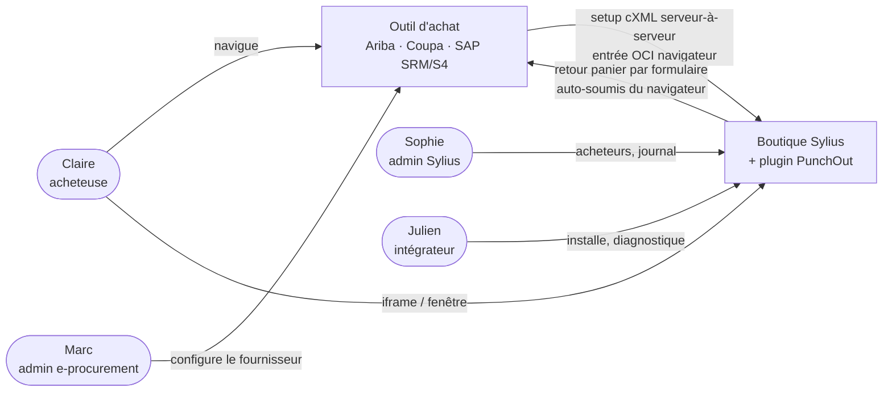
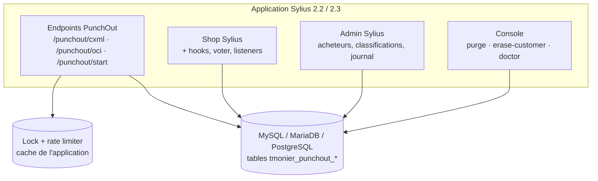
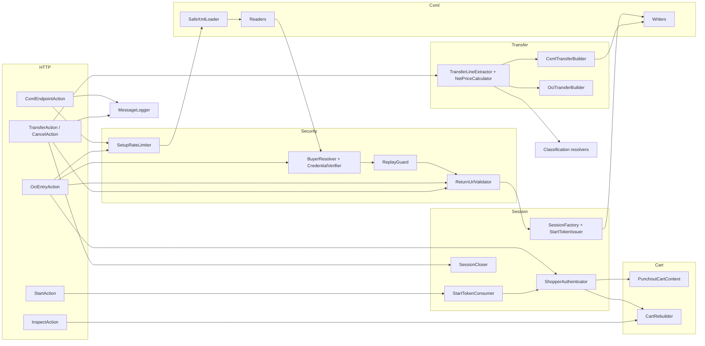
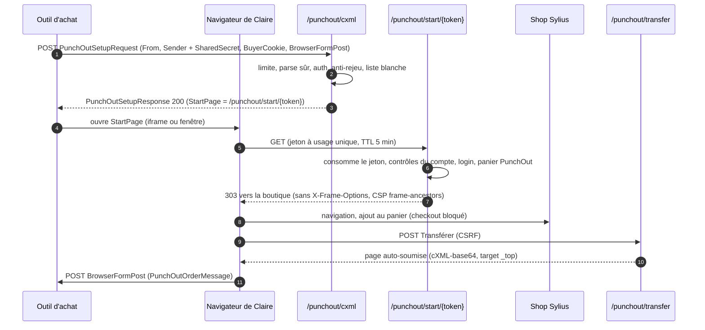
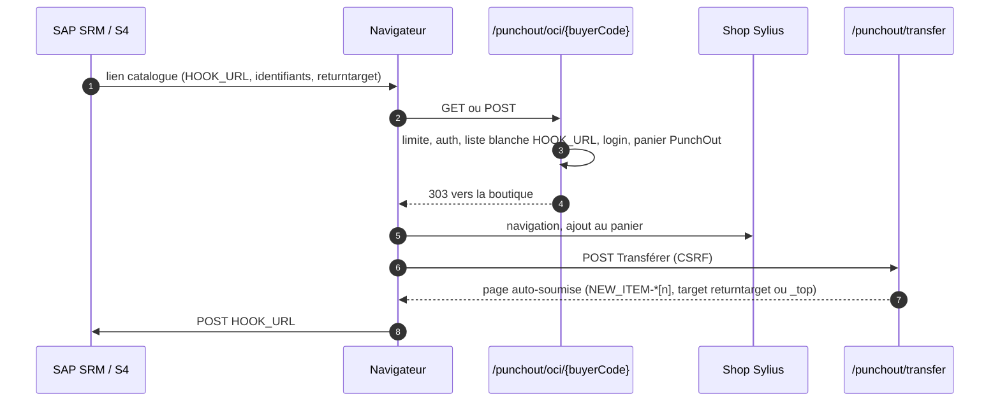

# Architecture C4 et séquences

> Phase 3 (Conception) · 2026-10-14

## Niveau 1 — Contexte

Le retour du panier ne passe **jamais** par un appel serveur à serveur : c'est le navigateur de Claire qui poste le formulaire vers l'outil d'achat (cXML `BrowserFormPost`, OCI `HOOK_URL`).

## Niveau 2 — Conteneurs

## Niveau 3 — Composants (plugin)

## Séquence — PunchOut cXML create

## Séquence — OCI

## Séquence — edit

Setup avec `operation="edit"` et des `ItemOut` → session `pending` qui stocke les `ItemOut` → au démarrage, `CartRebuilder` reconstruit le panier (un seul `process()`, lignes indisponibles signalées) → même transfert qu'en create.
