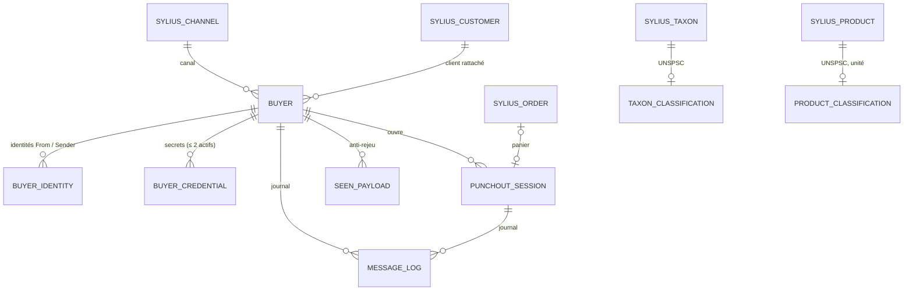

# Modèle de données

> Phase 3 (Conception) · 2026-10-14 · mapping Doctrine XML (`config/doctrine`), migrations en Schema API (MySQL, MariaDB, PostgreSQL), tables du plugin uniquement (ADR-001).

## `tmonier_punchout_buyer`

| Colonne | Type | Contraintes / notes |
|---|---|---|
| id | int PK | |
| code | varchar(64) | unique, `[a-z0-9_-]`, utilisé dans l'URL OCI |
| name | varchar(255) | |
| enabled | bool | défaut true |
| protocol | varchar(8) | `cxml` \| `oci` |
| channel_id | FK `sylius_channel` | NOT NULL, `ON DELETE RESTRICT` |
| customer_id | FK `sylius_customer` | **NOT NULL**, `ON DELETE RESTRICT` |
| company_id | int nullable | id company-accounts, sans FK (bundle optionnel) |
| locale_code | varchar(12) nullable | `xml:lang` des messages, défaut locale du canal |
| allowed_return_hosts | json | motifs d'hôte (`s1.ariba.com`, `*.ariba.com`), HTTPS implicite |
| frame_ancestors | json | origines complètes (`https://s1.ariba.com`) |
| default_unit | varchar(8) | défaut `EA` |
| default_unspsc | varchar(16) nullable | |
| oci_unit_map | json nullable | correspondance unité → code attendu par le SAP du client |
| oci_username_param / oci_password_param | varchar(32) | défaut `USERNAME` / `PASSWORD` |
| oci_username | varchar(255) nullable | |
| include_tax / include_shipping | bool | défaut false |
| created_at / updated_at | datetime_immutable | |

## `tmonier_punchout_buyer_identity`

| Colonne | Type | Notes |
|---|---|---|
| id | int PK | |
| buyer_id | FK, `ON DELETE CASCADE` | |
| role | varchar(8) | `from` \| `sender` |
| domain | varchar(64) | ex. `NetworkId`, `DUNS` (comparaison insensible à la casse) |
| identity | varchar(255) | |

Index unique (`role`, `domain_normalized`, `identity`) : une identité désigne un seul acheteur.

## `tmonier_punchout_buyer_credential`

| Colonne | Type | Notes |
|---|---|---|
| id | int PK | |
| buyer_id | FK, `ON DELETE CASCADE` | |
| label | varchar(64) | ex. « 2026-10 » |
| secret_hash | varchar(255) | Argon2id (ADR-004) |
| created_at | datetime_immutable | |
| revoked_at | datetime_immutable nullable | |
| last_used_at | datetime_immutable nullable | aide à la rotation |

Règle applicative : au plus 2 secrets non révoqués par acheteur.

## `tmonier_punchout_session`

| Colonne | Type | Notes |
|---|---|---|
| id | int PK | |
| buyer_id | FK, `ON DELETE CASCADE` | |
| protocol | varchar(8) | |
| operation | varchar(8) | `create` \| `edit` \| `inspect` |
| status | varchar(16) | `pending`, `active`, `transferred`, `cancelled`, `expired` |
| buyer_cookie | varchar(255) nullable | cXML |
| return_url | varchar(2048) | `BrowserFormPost` ou `HOOK_URL` |
| oci_context | json nullable | `returntarget`, `http_content_charset`, champs `~` reçus |
| start_token_hash | char(64) nullable | SHA-256, index unique ; vidé après consommation |
| start_token_expires_at | datetime_immutable nullable | |
| request_payload_id | varchar(255) nullable | |
| items_out | json nullable | `ItemOut` normalisés (edit / inspect) |
| extrinsics | json nullable | uniquement `allowed_extrinsics` (données personnelles) |
| order_id | FK `sylius_order` nullable, `ON DELETE SET NULL` | panier PunchOut |
| customer_id | FK `sylius_customer` nullable, `ON DELETE SET NULL` | client connecté (copie, pour l'effacement) |
| created_at / started_at / closed_at | datetime_immutable | |

Index : (`status`, `created_at`) pour la purge ; (`customer_id`).

## `tmonier_punchout_seen_payload`

| Colonne | Type | Notes |
|---|---|---|
| id | int PK | |
| buyer_id | FK, `ON DELETE CASCADE` | |
| payload_hash | char(64) | SHA-256 du `payloadID` |
| expires_at | datetime_immutable | `timestamp` + fenêtre |

Index unique (`buyer_id`, `payload_hash`) : l'insertion concurrente du même `payloadID` échoue (contrainte, pas de verrou applicatif).

## `tmonier_punchout_message_log`

| Colonne | Type | Notes |
|---|---|---|
| id | int PK | |
| buyer_id | FK nullable, `ON DELETE SET NULL` | null si l'acheteur n'a pas été identifié |
| session_id | FK nullable, `ON DELETE SET NULL` | |
| direction | varchar(3) | `in` \| `out` |
| protocol | varchar(8) | |
| message_type | varchar(64) | `PunchOutSetupRequest`, `ProfileRequest`, `PunchOutOrderMessage`, `OciEntry`, `OciReturn`… |
| payload_id | varchar(255) nullable | |
| status_code | int nullable | statut cXML / HTTP |
| status_text | varchar(255) nullable | générique, jamais de détail sensible |
| body_sha256 | char(64) | |
| body | text nullable | masqué, seulement si `log_bodies: true` |
| created_at | datetime_immutable | |

Index : (`created_at`), (`buyer_id`, `created_at`).

## `tmonier_punchout_taxon_classification` / `tmonier_punchout_product_classification`

| Colonne | Type | Notes |
|---|---|---|
| id | int PK | |
| taxon_id / product_id | FK unique, `ON DELETE CASCADE` | |
| unspsc | varchar(16) nullable | 8 chiffres (validation) |
| unit | varchar(8) nullable | produit uniquement |

Résolution par défaut : produit → taxon principal puis ses parents → valeur par défaut de l'acheteur.
